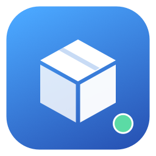

# Colima View

[](https://github.com/huyiqiu/colima-view/actions/workflows/ci.yml)
[](LICENSE)

English · [简体中文](README.zh-CN.md)

A native macOS desktop and menu bar app for managing [Colima](https://colima.run/) and Docker. Built with SwiftUI, with no third-party Swift dependencies, accounts, or telemetry.

## Features

- **Overview:** live container CPU and memory charts, engine information, running applications, and actual Mac storage usage.
- **Instances:** discover and switch profiles; create, start, stop, restart, resize, and delete instances.
- **Containers:** configure ports, mounts, environment variables, networks, restart policies, and commands; manage lifecycle, inspect, and view or export logs.
- **Images:** pull, build from a Dockerfile, select platforms, inspect, delete, and clear unused images or build cache.
- **Compose:** preview and deploy local files, then manage project services while preserving volumes.
- **Storage:** actual Mac allocation, VM used and available space, and Docker's image, container, volume, and build cache breakdown.
- **Volumes and networks:** create, inspect, and remove volumes and bridge networks.
- **Menu bar:** monochrome icon, optional container and resource summaries, and quick actions.
- **Settings:** English and Simplified Chinese, refresh interval, login item, tool paths, and proxy settings. English is the default.

The app uses your existing Colima installation and virtual machines. Closing the main window keeps the menu bar available; quitting the app keeps Colima and containers running.

## Requirements

- macOS 14 or later.
- Xcode 16 or later, including its command line tools, to build from source.
- Colima and Docker CLI, plus working `docker compose` and `docker buildx` commands.

Tools are detected in `/opt/homebrew/bin` and `/usr/local/bin`. Other locations can be selected in **Settings → Connection**.

## Build and run

Install runtime tools if needed:

```sh
brew install colima docker docker-compose docker-buildx
```

Follow the Homebrew formula's plugin setup instructions if `docker compose version` or `docker buildx version` cannot find an installed plugin. Start your existing Colima instance. If you do not have an instance yet, a modest configuration is:

```sh
colima start --cpu 2 --memory 2 --disk 20
```

Build the app:

```sh
git clone https://github.com/huyiqiu/colima-view.git
cd colima-view
bash scripts/build-app.sh
open "dist/Colima View.app"
```

You can move the built app to Applications. The build script creates a locally ad-hoc signed app for the machine's architecture. This project does not provide a notarized release; public binary distribution requires appropriate Developer ID signing and notarization.

## Storage and language

Open **Storage** for actual allocated Mac space, the selected instance's VM disk usage, and Docker categories. Measurements refresh every minute and can be refreshed manually. Mac allocation remains available while an instance is stopped.

Mac allocation uses `COLIMA_HOME`, or `~/.colima` by default. A configured disk capacity is not actual allocated space. Images and build cache can share data, so category sizes cannot be added to determine actual usage. Mac and VM measurements use binary units such as GiB; Docker categories retain Docker's units.

Switch languages immediately in **Settings → General → Language**.

## Verification

```sh
swift test --disable-sandbox
bash scripts/build-app.sh

# Read-only checks against an already running local Docker profile
swift run --disable-sandbox colima-desk-check

# Creates and removes temporary test resources; requires hello-world locally
swift run --disable-sandbox colima-desk-check --smoke-test
```

Unit tests do not need Docker. The smoke test covers container lifecycle, logs, inspection, a scratch image build, volumes, networks, and Compose deployment. It cleans up its temporary resources and does not download test images. CI runs unit tests and builds the app on macOS.

## Connection troubleshooting

If the shell's Docker CLI points to `/var/run/docker.sock` after switching or stopping runtimes:

```sh
docker context use colima
docker ps
```

Use `colima-PROFILE` for a named profile. App Docker requests explicitly select the active profile's context.

## Scope and contributions

Colima View manages local Docker-based Colima instances. Kubernetes resource management, remote hosts, and an interactive terminal are outside the current scope. Compose files must remain accessible at their original paths.

Menu bar CPU and memory figures are totals for running containers, not the entire Mac or VM. CPU usage of 100% represents one core.

Issues and pull requests are welcome; see [CONTRIBUTING.md](CONTRIBUTING.md). Remove credentials and private project data from diagnostic logs.

## License

[MIT](LICENSE). External tools such as Colima, Docker, and Lima retain their own licenses and are not bundled in this repository.

This is an independent project and is not affiliated with Docker or the Colima project.
