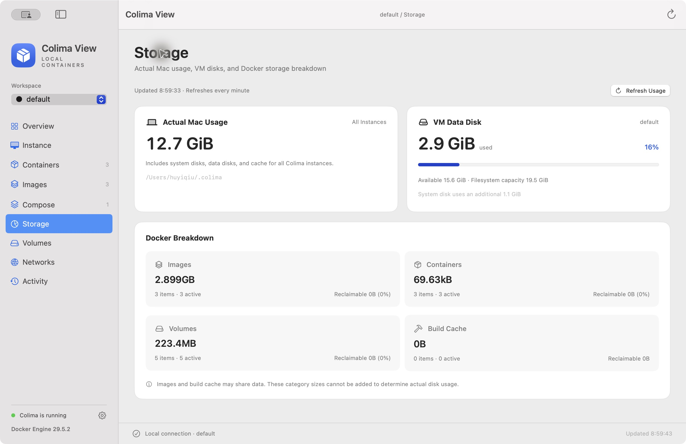
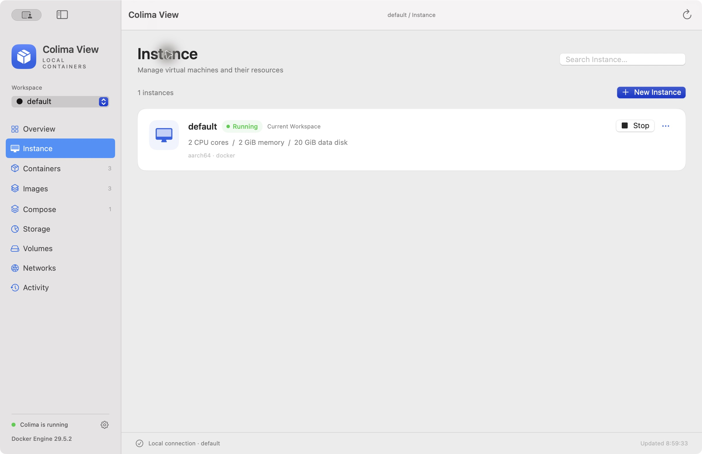
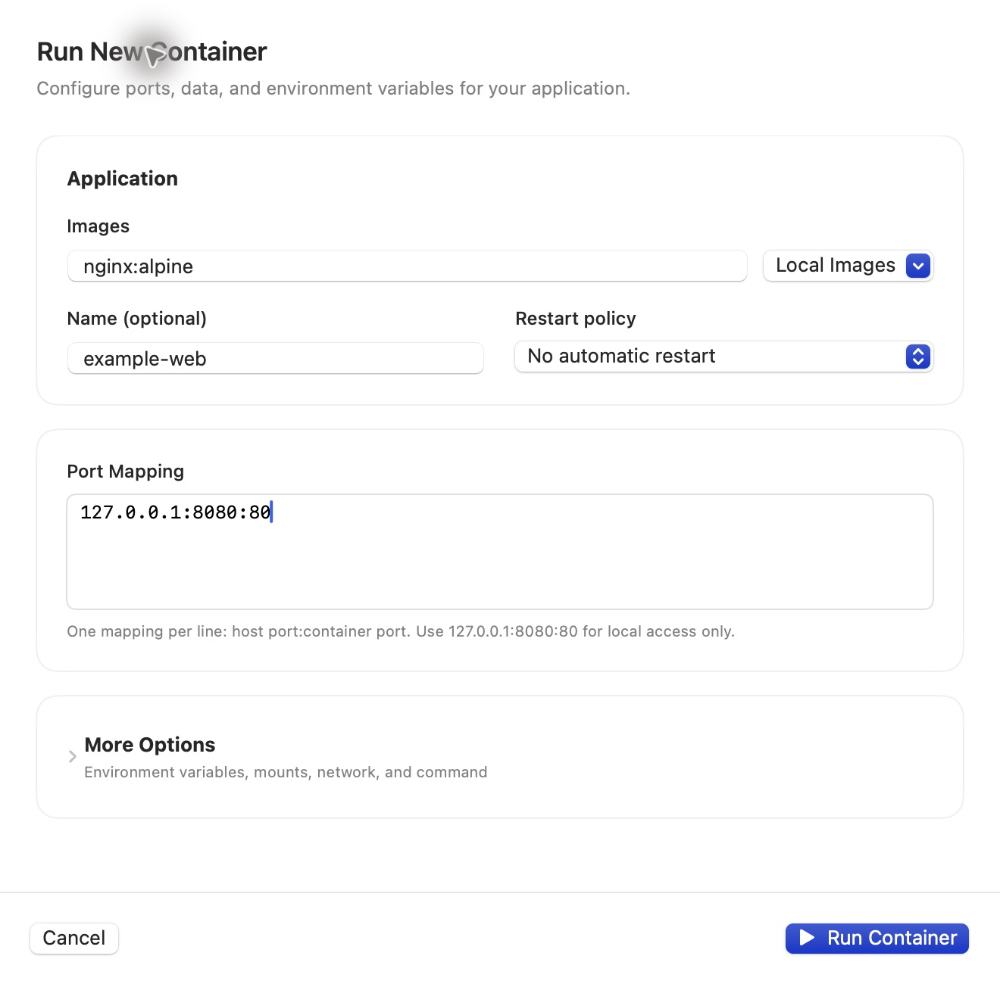

# Colima View

[English](README.md) · 简体中文

原生 SwiftUI macOS 桌面客户端，复用本机 Colima / Docker CLI。最低支持 macOS 14，无第三方 Swift 依赖、账户或遥测。

## 界面展示

**存储占用**：集中查看 Mac 实际分配空间、虚拟机磁盘用量，以及 Docker 各类资源的占用与可回收量。



| 实例管理 | 创建容器 |
| --- | --- |
|  |  |

截图展示默认的英文界面；容器表单使用示例配置。应用也支持简体中文。

## 使用

需要已安装 Colima、Docker CLI，以及可用的 `docker compose` 和 `docker buildx`。首次从源码使用：

```bash
git clone https://github.com/huyiqiu/colima-view.git
cd colima-view
bash scripts/build-app.sh
open "dist/Colima View.app"
```


双击 `dist/Colima View.app`，也可以将它拖入“应用程序”。菜单栏中的箱子图标可随时打开主窗口；关闭窗口后菜单栏仍然运行。退出客户端会保留 Colima 与容器。

首次打开会自动查找 `/opt/homebrew/bin` 或 `/usr/local/bin` 中的 Colima 和 Docker。其他安装位置可以在“设置 → 连接”中选择。Docker Compose 需要已经安装。

## 功能

- 概览：真实 CPU / 内存曲线、Mac 存储占用、运行容器、实例配置与引擎信息。
- 实例：发现和切换多个 profile，启动、停止、重启、新建、调整资源、删除。数据盘禁止缩小；删除实例会删除其内部数据，操作前有确认。
- 容器：搜索、状态过滤、创建、端口发布、卷挂载、环境变量、网络和重启策略；启停、重启、暂停、恢复和删除；日志自动刷新、搜索、复制、导出、Inspect 和端口打开。
- 镜像：拉取、平台选择、从 Dockerfile 构建（上下文、标签、参数、缓存选项）、创建容器、详情、删除、清理未使用镜像和构建缓存。
- Compose：文件预览与部署、启动、停止、重启、移除项目容器（保留卷）。
- 存储占用：Mac 上全部 Colima 实例的实际分配占用、当前实例的数据盘已用 / 可用 / 使用率、系统盘用量，以及镜像、容器、存储卷和构建缓存的分类与可回收量。每分钟自动更新，也可手动刷新；实例停止时仍可查看 Mac 占用。
- 存储卷与网络：创建、检查和删除卷 / bridge 网络；保护系统默认网络。
- 菜单栏：实例状态、容器数量、CPU / 内存简报、快捷启停和容器速览，可自定义显示内容。
- 设置：英文 / 简体中文即时切换（默认英文）、刷新周期、登录启动、可执行文件位置、宿主机下载代理与虚拟机代理。
- 活动记录：后台任务、流式进度、执行结果与诊断输出，仅在当前会话保存。

## 构建与验证

需要 Xcode 16 / Swift 5.10 或更新版本。全部操作都在项目目录进行：

```bash
bash scripts/build-app.sh
swift test --disable-sandbox
swift run --disable-sandbox colima-desk-check
swift run --disable-sandbox colima-desk-check --smoke-test
```

最后一项需要一个已经运行的 Docker profile 和本地 `hello-world` 镜像。它会使用随机名称验证容器生命周期、日志、Inspect、scratch 镜像构建、存储卷 / 网络和 Compose 部署，并清理所有测试资源；不下载额外镜像。

`scripts/build-app.sh` 构建 Release 应用、生成图标并进行本机 ad-hoc 签名。跨机器公开分发时应另行使用 Developer ID 签名和 Apple 公证。

## 实现约定

`ColimaCore` 负责可测试的命令执行、模型和 Docker 接入；`ColimaDesk` 负责原生界面与菜单栏；`ColimaProbe` 是真实环境的端到端检查工具。

命令通过 `Process` 和独立参数执行，用户输入不会经过 shell。Docker 每次明确指定所选 profile 的 context，避免切换本机默认 context。读取命令有超时与取消处理，stdout / stderr 分别并发读取；所有长操作在后台执行，刷新任务会忽略过期结果。虚拟机与 Docker 数据仍由 Colima 原有目录管理，应用不会复制现有数据盘。

菜单栏 CPU / 内存表示运行中容器的合计用量，不代表整个 macOS 或整个虚拟机的占用；CPU 100% 表示一个核心。图表仅保留当前会话最近 90 次采样。日志展示最近 500 行，每 3 秒刷新。

“存储占用”通过 `du -sk` 读取 Colima 目录实际分配的磁盘块，通过虚拟机 `df -Pk` 读取文件系统用量，并通过 `docker system df` 读取分类。支持 `COLIMA_HOME` 环境变量；默认目录为 `~/.colima`。物理占用和虚拟机数据盘使用二进制单位（GiB），Docker 分类保留其原始单位。镜像与构建缓存可能共享数据，不能将分类简单相加；读取失败会显示不可用和错误信息，不将失败统计显示为零。

当前面向本机 Docker 运行时；不提供 Kubernetes 资源管理、远程主机管理或交互式终端模拟器。Compose 项目需要本机仍可访问原配置文件。

本项目与 Colima、Docker 官方无隶属关系。

## 贡献与许可证

欢迎提交 Issue 和 Pull Request。开发与验证说明见 [CONTRIBUTING.md](CONTRIBUTING.md)。

采用 [MIT 许可证](LICENSE)。Colima、Docker、Lima 等外部工具保留各自的许可证；本仓库不包含它们的二进制文件。
